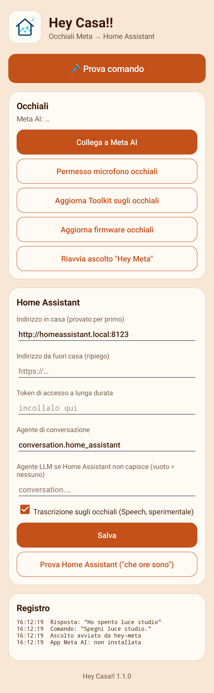
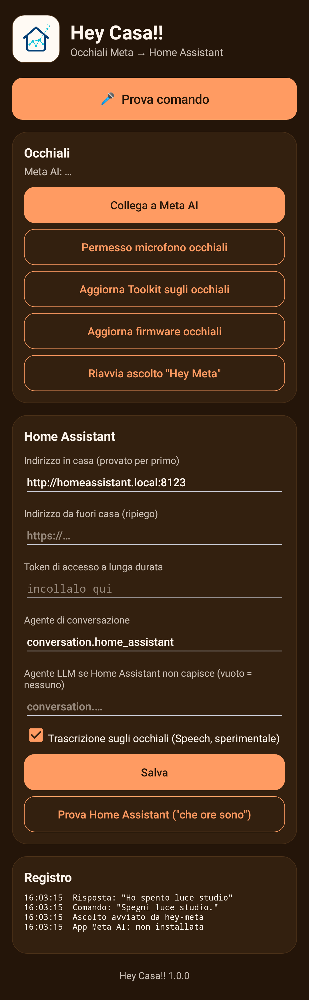

<p align="center"></p>

# Hey Casa!!

[English](README.md) · **Italiano**

App Android per comandare **Home Assistant** a voce dagli occhiali **Meta** (Ray-Ban Meta, Oakley Meta),
costruita sul [Meta Wearables Device Access Toolkit](https://wearables.developer.meta.com/) 1.0.

Dici il comando agli occhiali, l'app lo passa all'assistente di Home Assistant e la risposta ti viene
letta all'orecchio:

> «Spegni la luce dello studio» → «Ho spento luce studio»

<p align="center">
  
  &nbsp;&nbsp;
  
</p>

<sub>Le schermate sono disegnate dal layout vero con un test Robolectric (`ScreenshotTest`), con tre
righe di registro di esempio.</sub>

## Indice

- [Come funziona](#come-funziona)
- [Cosa serve](#cosa-serve)
- [Avvio rapido (Developer Mode)](#avvio-rapido-developer-mode)
- [Collegamento con un account sviluppatore Meta](#collegamento-con-un-account-sviluppatore-meta)
- [Cambiare il comando vocale](#cambiare-il-comando-vocale)
- [Compilare](#compilare)
- [Limiti](#limiti)

## Come funziona

1. L'ascolto parte da **"Ehi Meta, apri …"**, dal **riquadro nelle impostazioni rapide** o dal
   pulsante "Prova comando".
2. La frase viene trascritta sugli occhiali (Speech del toolkit). Se non è disponibile, ci pensa il
   riconoscimento vocale del telefono, con il microfono degli occhiali via Bluetooth.
3. Il testo va a `POST /api/conversation/process` di Home Assistant.
4. Se Home Assistant non capisce (`no_intent_match`, `no_valid_targets`), la frase passa a un
   secondo agente, per esempio un LLM. La conversazione resta aperta tre minuti, così "ora spegnila"
   sa di cosa si parla.
5. La risposta viene letta negli occhiali.

L'app prova prima l'indirizzo di casa, con un timeout breve, e poi quello esterno. Serve quando dal
Wi-Fi di casa il dominio pubblico non è raggiungibile.

## Cosa serve

- Occhiali supportati dal toolkit, firmware V128 o successivo, e app Meta AI V290 o successiva.
- Telefono Android 12 o successivo, a 64 bit.
- Home Assistant con un [token di accesso a lunga durata](https://www.home-assistant.io/docs/authentication/#your-account-profile).

## Avvio rapido (Developer Mode)

Per questa strada non serve un account sviluppatore Meta.

1. In Meta AI: **Impostazioni → Info app**, cinque tocchi sul numero di versione, attiva la **Developer Mode**.
2. Installa l'APK dalle [release](../../releases) e apri Hey Casa!!. Concedi Bluetooth e microfono.
3. Tocca **Collega a Meta AI**, poi **Permesso microfono occhiali**.
4. Se compare "Your glasses need an update", tocca **Aggiorna Toolkit sugli occhiali** con gli
   occhiali indossati.
5. Nella scheda **Home Assistant** scrivi indirizzo e token, tocca **Salva**, poi **Prova Home Assistant**.
6. Tocca **Prova comando** con gli occhiali addosso.
7. Aggiungi il riquadro **Hey Casa!!** alle impostazioni rapide: avvia l'ascolto senza aprire l'app.

Il token resta nelle preferenze dell'app sul telefono. Non è nell'APK.

In Developer Mode riquadro e pulsante funzionano, ma Meta AI può non consegnare all'app le
invocazioni di "Ehi Meta". Per l'uso a mani libere segui la sezione qui sotto.

## Collegamento con un account sviluppatore Meta

È la configurazione usata dall'autore. Registra la tua build come progetto nel
[Wearables Developer Center](https://wearables.developer.meta.com/) e la distribuisce a te stesso
con un canale di rilascio privato, a Developer Mode spenta. Così "Ehi Meta, apri …" arriva all'app.

Serve una build tua, perché Meta lega il progetto al tuo nome di pacchetto e alla tua chiave di firma.

### 1. Crea la chiave di firma

```bash
keytool -genkeypair -v -keystore keystore/heycasa.jks -alias heycasa \
  -keyalg RSA -keysize 4096 -validity 36500 -storetype PKCS12
```

Conserva chiave e password. Se le perdi, cambia la firma registrata su Meta e il progetto va
configurato di nuovo.

Meta vuole la SHA-256 del certificato in **base64url senza padding**, non nella solita forma esadecimale:

```bash
keytool -exportcert -keystore keystore/heycasa.jks -alias heycasa \
  | openssl dgst -sha256 -binary | openssl base64 -A | tr '+/' '-_' | tr -d '='
```

### 2. Crea il progetto

1. Entra nel [Wearables Developer Center](https://wearables.developer.meta.com/) e completa
   l'onboarding (ti viene creata un'organizzazione tua).
2. Clicca **New project** e dai un nome e una breve descrizione.
3. Apri **Configuration** e aggiungi l'app Android: il tuo **package name** (scegline uno, per
   esempio `com.example.heycasa`) e la **firma** calcolata sopra.
4. Compila nome e icona dell'app. **Il nome dell'app è quello che dirai dopo "Ehi Meta, apri"**:
   sceglilo con cura (vedi [Cambiare il comando vocale](#cambiare-il-comando-vocale)).
   La documentazione chiede icone fino a 200×200; nel nostro caso il modulo ha accettato solo PNG
   1024×1024. [`docs/icona-1024.png`](docs/icona-1024.png) è pronta.
5. Apri **Permissions** e chiedi il **microfono**, con una breve motivazione. Al momento la voice
   invocation non ha un interruttore nella dashboard: lo staff Meta dice che è concessa
   temporaneamente a tutte le app.
6. Copia **Application ID** e **Client Token** del progetto.

### 3. Compila la tua edizione

Crea questi tre file in `keystore/` (la cartella è ignorata da git):

`keystore/keystore.properties`
```properties
storeFile=keystore/heycasa.jks
storePassword=…
keyAlias=heycasa
keyPassword=…
```

`keystore/mwdat.properties`
```properties
mwdat_application_id=…
mwdat_client_token=…
```

`keystore/prv.properties`
```properties
application_id=com.example.heycasa
# facoltativi: valori già compilati nelle impostazioni e nome mostrato sul telefono
ha_url=http://homeassistant.local:8123
ha_url_remote=https://ha.example.com
llm_agent=
app_name=Hey Casa!!
```

Poi compila e installa:

```bash
./gradlew assemblePrvRelease
```

L'APK esce in `app/build/outputs/apk/prv/release/`. La versione prende il suffisso `prv`.

### 4. Pubblica una versione per te stesso

1. Nel Developer Center vai in **Distribute → Versions**, clicca **Create new version**, scegli
   **Major**, **Minor** o **Patch**, poi **Create version**.
2. Aspetta che la versione sia **Ready** nella dashboard **Distribution**. Di solito bastano dieci
   minuti, a volte ne servono trenta.
3. Vai in **Distribute → Release channels**, apri **Beta → View**. Nella scheda **Version** clicca
   **Edit**, scegli la versione, **Save changes**.
4. Nella scheda **Users** clicca **+ Invite users**, scrivi l'email dell'account Meta che usi
   nell'app Meta AI, **Send invites**.
5. Accetta l'invito dall'email, oppure da <https://wearables.meta.com/invites>.

### 5. Collega il telefono

1. In Meta AI apri **Impostazioni** del dispositivo **→ Release Channel** e controlla che sia
   selezionato il tuo canale Beta.
2. **Spegni la Developer Mode**.
3. Se l'app era già collegata in Developer Mode, toglila da **Impostazioni → Connessioni app**.
4. Apri Hey Casa!!, tocca **Collega a Meta AI**, poi **Permesso microfono occhiali**.
5. Tieni gli occhiali collegati per circa quindici minuti, poi di' **"Ehi Meta, apri *nome della tua app*"**.

## Cambiare il comando vocale

La frase ha sempre questa forma:

> **Ehi Meta, apri** *nome* &nbsp;(in inglese: **Hey Meta, open** *name*)

"Ehi Meta, apri" appartiene agli occhiali: non si può cambiare né togliere. Quello che scegli è il
*nome*. Se l'app si chiama "Casa" dici "Ehi Meta, apri Casa"; se la chiami "Hey Casa" dici
"Ehi Meta, apri Hey Casa". Dopo il bip dell'app dici il comando per Home Assistant.

Da dove viene il nome dipende da come è collegata l'app.

### Con un progetto nel Developer Center (Developer Mode spenta)

Il nome è il **nome dell'app del progetto nel Developer Center**, non quello sul telefono.

1. Nel Developer Center apri il progetto e cambia il nome dell'app.
2. Crea una versione nuova: **Distribute → Versions → Create new version**. Il nome nuovo vale solo
   da una versione nuova.
3. Aspetta **Ready**, poi assegnala: **Distribute → Release channels → Beta → View → Version →
   Edit → Save changes**.
4. Sul telefono, in Meta AI: **Impostazioni → Connessioni app**, togli l'app. Apri Hey Casa!! e
   tocca di nuovo **Collega a Meta AI**.
5. Tieni gli occhiali collegati per circa quindici minuti prima di provare.

Non serve ricompilare né reinstallare l'APK.

### In Developer Mode

Il nome è il **nome dell'app sul telefono**. Ricompila con il nome che vuoi e reinstalla:

```bash
./gradlew assemblePubblicaRelease -PappName="Casa"
```

Per l'edizione `prv` imposta invece `app_name=` in `keystore/prv.properties`. Poi aspetta circa
quindici minuti con gli occhiali collegati.

### Scegliere un nome che funziona

- Le maiuscole non contano, **gli spazi sì**: "Casa Mia" e "CasaMia" sono nomi diversi.
- Meglio una o due parole semplici nella lingua in cui parli agli occhiali. Evita punteggiatura e cifre.
- Evita le parole su cui Meta AI agisce già da sola, come "musica", "fotocamera" o "WhatsApp".
- Se gli occhiali rispondono ma nell'app non succede nulla, tocca **Riavvia ascolto "Hey Meta"** e
  leggi la scheda **Registro**: la riga "Hey Meta: invocazione ricevuta ✓" dice che il comando è arrivato.

## Compilare

Servono JDK 17 e l'SDK Android (platform 36).

```bash
./gradlew assemblePubblicaRelease
```

L'APK esce in `app/build/outputs/apk/pubblica/release/`, firmato con la chiave di debug della macchina.

Lo stesso codice ha due edizioni:

| Edizione | Task | Cosa contiene |
|---|---|---|
| `pubblica` | `assemblePubblicaRelease` | nessuna credenziale, Developer Mode, firma di debug |
| `prv` | `assemblePrvRelease` | la tua firma, le tue credenziali del Developer Center e le tue impostazioni predefinite, lette da `keystore/` |

Per ridisegnare le schermate: `./gradlew testPubblicaReleaseUnitTest`.

| File | Cosa fa |
|---|---|
| `CasaApp.kt` | avvio del toolkit, canale di "Hey Meta" con riapertura automatica, registro |
| `Assistant.kt` | ascolto, chiamata a Home Assistant, secondo agente, lettura della risposta |
| `MainActivity.kt` | impostazioni e pulsanti |
| `ListenActivity.kt` | riquadro trasparente che tiene l'app in primo piano durante l'ascolto |
| `CasaTileService.kt` | riquadro nelle impostazioni rapide |

## Limiti

- Voice invocation e Speech sono sperimentali nel toolkit 1.0: funzionano nei canali di sviluppo e
  beta, non in produzione.
- La Developer Mode registra una sola app di terze parti alla volta.
- Se Meta segnala `INSUFFICIENT_SDK_VERSION` va aggiornato `mwdat` in `gradle/libs.versions.toml`.
- Interfaccia, riconoscimento e sintesi vocale sono in italiano.

## Licenza

[MIT](LICENSE)
