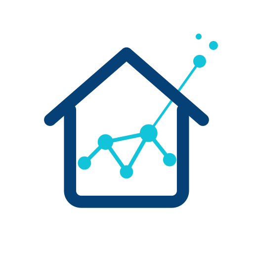

<p align="center"></p>

# Hey Casa!!

App Android per comandare **Home Assistant** a voce dagli occhiali **Meta** (Ray-Ban Meta, Oakley Meta),
costruita sul [Meta Wearables Device Access Toolkit](https://wearables.developer.meta.com/) 1.0.

Dici il comando agli occhiali, l'app lo passa all'assistente di Home Assistant e la risposta ti viene
letta negli occhiali:

> «Spegni la luce dello studio» → «Ho spento luce studio»

## Come funziona

1. L'ascolto parte da **"Hey Meta, apri …"**, dal **riquadro nelle impostazioni rapide** o dal pulsante
   "Prova comando".
2. La frase viene trascritta sugli occhiali (Speech del toolkit). Se non è disponibile, ci pensa il
   riconoscimento vocale del telefono con il microfono degli occhiali via Bluetooth.
3. Il testo va a `POST /api/conversation/process` di Home Assistant.
4. Se Home Assistant non capisce (`no_intent_match`, `no_valid_targets`) la frase passa a un secondo
   agente, per esempio un LLM. La conversazione resta aperta tre minuti, così "ora spegnila" sa di
   cosa si parla.
5. La risposta viene letta negli occhiali.

L'app prova prima l'indirizzo di casa (timeout breve) e poi quello esterno: serve quando dal Wi-Fi
di casa il dominio pubblico non è raggiungibile.

## Cosa serve

- Occhiali supportati dal toolkit, firmware V128 o successivo, e app Meta AI V290 o successiva.
- Telefono Android 12 o successivo, a 64 bit.
- Home Assistant con un [token di accesso a lunga durata](https://www.home-assistant.io/docs/authentication/#your-account-profile).

## Primo avvio

1. In Meta AI: Impostazioni → Info app → cinque tocchi sul numero di versione → attiva la **Developer Mode**.
2. Installa l'APK e apri Hey Casa!!: concedi Bluetooth e microfono.
3. "Collega a Meta AI", poi "Permesso microfono occhiali".
4. Se compare "Your glasses need an update", usa "Aggiorna Toolkit sugli occhiali" con gli occhiali indossati.
5. Scrivi indirizzo e token di Home Assistant, "Salva", poi "Prova Home Assistant".
6. "Prova comando" con gli occhiali addosso.

Il token resta nelle preferenze dell'app sul telefono, non finisce nell'APK.

## Compilare

Servono JDK 17 e l'SDK Android (platform 36).

```bash
./gradlew assemblePubblicaRelease
```

L'APK esce in `app/build/outputs/apk/pubblica/release/`, firmato con la chiave di debug della macchina.

### Edizione personale

Lo stesso codice ha una seconda edizione, `prv`, che prende i dati da tre file nella cartella
`keystore/`, ignorata da git. Ogni file è facoltativo.

| File | Contenuto |
|---|---|
| `keystore.properties` | `storeFile` (percorso dalla radice del progetto), `storePassword`, `keyAlias`, `keyPassword` |
| `mwdat.properties` | `mwdat_application_id`, `mwdat_client_token` del progetto nel Wearables Developer Center |
| `prv.properties` | `application_id`, `ha_url`, `ha_url_remote`, `llm_agent`: i valori già compilati nelle impostazioni |

```bash
./gradlew assemblePrvRelease
```

La versione prende il suffisso `prv` (per esempio `1.0.0prv`).

## "Hey Meta"

- In Developer Mode il nome da pronunciare è quello dell'app sul telefono. Con un progetto nel
  Developer Center (edizione `prv`, Developer Mode spenta) è il nome dato lì al progetto.
- Dopo una modifica servono circa 15 minuti con gli occhiali collegati perché il nome arrivi agli occhiali.
- In Developer Mode Meta AI può non consegnare le invocazioni: Meta consiglia un canale di rilascio
  beta nel Developer Center. Il riquadro nelle impostazioni rapide funziona sempre.

## Limiti

- Voice invocation e Speech sono sperimentali nel toolkit 1.0: funzionano nei canali di sviluppo e
  beta, non in produzione.
- La Developer Mode registra una sola app di terze parti alla volta.
- Se Meta segnala `INSUFFICIENT_SDK_VERSION` va aggiornato `mwdat` in `gradle/libs.versions.toml`.
- Interfaccia, riconoscimento e sintesi vocale sono in italiano.

## Codice

| File | Cosa fa |
|---|---|
| `CasaApp.kt` | avvio del toolkit, canale di "Hey Meta" con riapertura automatica, registro |
| `Assistant.kt` | ascolto, chiamata a Home Assistant, secondo agente, lettura della risposta |
| `MainActivity.kt` | impostazioni e pulsanti |
| `ListenActivity.kt` | riquadro trasparente che tiene l'app in primo piano durante l'ascolto |
| `CasaTileService.kt` | riquadro nelle impostazioni rapide |
