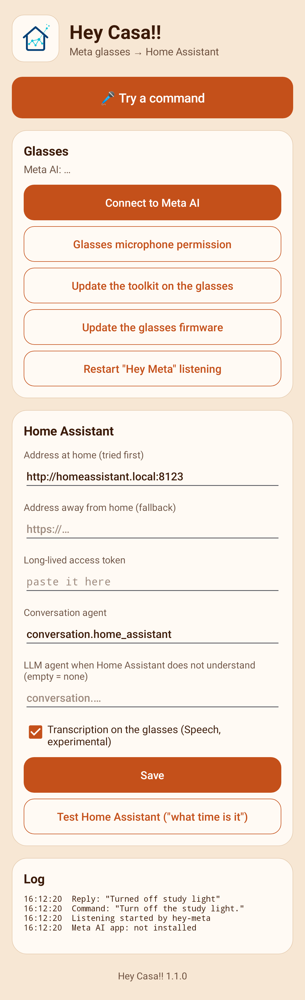
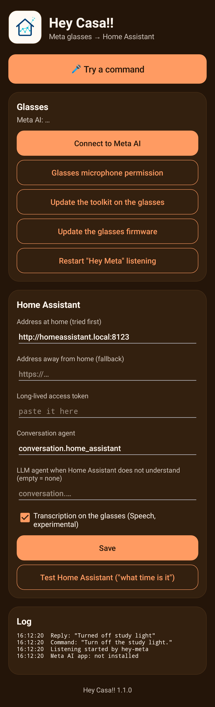

<p align="center"></p>

# Hey Casa!!

**English** · [Italiano](README.it.md)

An Android app to control **Home Assistant** by voice from **Meta** smart glasses (Ray-Ban Meta,
Oakley Meta), built on the [Meta Wearables Device Access Toolkit](https://wearables.developer.meta.com/) 1.0.

You speak to the glasses, the app hands the sentence to Home Assistant's conversation agent, and
the answer is read back in your ear:

> "Turn off the study light" → "Turned off the study light"

<p align="center">
  
  &nbsp;&nbsp;
  
</p>

<sub>The screenshots are drawn from the real layout by a Robolectric test (`ScreenshotTest`), with
three sample log lines.</sub>

## Contents

- [How it works](#how-it-works)
- [Requirements](#requirements)
- [Languages](#languages)
- [Quick start (Developer Mode)](#quick-start-developer-mode)
- [Connecting through a Meta developer account](#connecting-through-a-meta-developer-account)
- [Changing the voice command](#changing-the-voice-command)
- [Building](#building)
- [Limits](#limits)

## How it works

1. Listening starts from **"Hey Meta, open …"**, from the **Quick Settings tile**, or from the
   **Try a command** button.
2. The sentence is transcribed on the glasses (the toolkit's Speech feature). If that is not
   available, the phone's speech recogniser takes over, using the glasses' microphone over Bluetooth.
3. The text goes to Home Assistant's `POST /api/conversation/process`.
4. If Home Assistant does not understand (`no_intent_match`, `no_valid_targets`), the sentence is
   passed to a second agent, for example an LLM. That conversation stays open for three minutes, so
   "now turn it off" knows what "it" is.
5. The answer is read in the glasses.

The app tries the home address first, with a short timeout, and then the external one. This helps
when the public domain is not reachable from your own Wi-Fi.

## Requirements

- Glasses supported by the toolkit, firmware V128 or later, and the Meta AI app V290 or later.
- An Android 12+ phone, 64-bit.
- Home Assistant with a [long-lived access token](https://www.home-assistant.io/docs/authentication/#your-account-profile).

## Languages

The app follows the phone's language: **Italian** if the phone is set to Italian, **English**
otherwise. The language applies to the interface, to the phone's speech recogniser, to the language
sent to Home Assistant and to the voice that reads the answer.

Transcription on the glasses follows the language of the glasses, and Home Assistant must have that
language available for its conversation agent.

## Quick start (Developer Mode)

No Meta developer account is needed for this path.

1. In Meta AI: **Settings → App Info**, tap the version number five times, turn on **Developer Mode**.
2. Install the APK from the [releases](../../releases) and open Hey Casa!!. Allow Bluetooth and microphone.
3. Tap **Connect to Meta AI**, then **Glasses microphone permission**.
4. If you see "Your glasses need an update", tap **Update the toolkit on the glasses** while
   wearing them.
5. Under **Home Assistant**, enter the address and the token, tap **Save**, then
   **Test Home Assistant**.
6. Tap **Try a command** with the glasses on.
7. Add the **Hey Casa!!** tile to Quick Settings: it starts listening without opening the app.

The token stays in the app's preferences on the phone. It is not in the APK.

In Developer Mode the tile and the button work, but Meta AI may not deliver "Hey Meta" invocations
to the app. For hands-free use, follow the next section.

## Connecting through a Meta developer account

This is the setup the author uses. It registers your own build as a project in the
[Wearables Developer Center](https://wearables.developer.meta.com/) and distributes it to yourself
through a private release channel, with Developer Mode off. With it, "Hey Meta, open …" reaches the app.

It needs your own build, because Meta ties the project to your package name and your signing key.

### 1. Create a signing key

```bash
keytool -genkeypair -v -keystore keystore/heycasa.jks -alias heycasa \
  -keyalg RSA -keysize 4096 -validity 36500 -storetype PKCS12
```

Keep the key and its password safe. If you lose them, the signature registered with Meta changes
and the project has to be configured again.

Meta wants the certificate's SHA-256 in **base64url without padding**, not in the usual hex form:

```bash
keytool -exportcert -keystore keystore/heycasa.jks -alias heycasa \
  | openssl dgst -sha256 -binary | openssl base64 -A | tr '+/' '-_' | tr -d '='
```

### 2. Create the project

1. Sign in to the [Wearables Developer Center](https://wearables.developer.meta.com/) and complete
   the onboarding (you get an organisation of your own).
2. Click **New project** and give it a name and a short description.
3. Open **Configuration** and add the Android app: your **package name** (pick one, for example
   `com.example.heycasa`) and the **signature** computed above.
4. Fill in the app name and icon. The **app name is what you will say after "Hey Meta, open"**, so
   choose it with care (see [Changing the voice command](#changing-the-voice-command)).
   The documentation asks for icons up to 200×200; in our case the form accepted only
   1024×1024 PNGs. [`docs/icona-1024.png`](docs/icona-1024.png) is ready to use.
5. Open **Permissions** and request **microphone**, with a short justification. At the time of
   writing, voice invocation has no switch in the dashboard: Meta staff say it is temporarily
   granted to every app.
6. Copy the project's **Application ID** and **Client Token**.

### 3. Build your edition

Create these three files in `keystore/` (the folder is ignored by git):

`keystore/keystore.properties`
```properties
storeFile=keystore/heycasa.jks
storePassword=…
keyAlias=heycasa
keyPassword=…
```

`keystore/mwdat.properties`
```properties
mwdat_application_id=…
mwdat_client_token=…
```

`keystore/prv.properties`
```properties
application_id=com.example.heycasa
# optional: values pre-filled in the settings, and the name shown on the phone
ha_url=http://homeassistant.local:8123
ha_url_remote=https://ha.example.com
llm_agent=
app_name=Hey Casa!!
```

Then build and install:

```bash
./gradlew assemblePrvRelease
```

The APK is in `app/build/outputs/apk/prv/release/`. Its version has the `prv` suffix.

### 4. Publish a version to yourself

1. In the Developer Center go to **Distribute → Versions**, click **Create new version**, choose
   **Major**, **Minor** or **Patch**, then **Create version**.
2. Wait until the version is **Ready** in the **Distribution** dashboard. It usually takes about
   ten minutes, sometimes up to thirty.
3. Go to **Distribute → Release channels**, open **Beta → View**. In the **Version** tab click
   **Edit**, choose the version, **Save changes**.
4. In the **Users** tab click **+ Invite users**, enter the email of the Meta account you use in
   the Meta AI app, **Send invites**.
5. Accept the invitation from the email, or at <https://wearables.meta.com/invites>.

### 5. Connect the phone

1. In Meta AI, open the device **Settings → Release Channel** and check that your Beta channel is selected.
2. Turn **Developer Mode off**.
3. If the app was connected before in Developer Mode, remove it under **Settings → App connections**.
4. Open Hey Casa!!, tap **Connect to Meta AI**, then **Glasses microphone permission**.
5. Keep the glasses connected for about fifteen minutes, then say **"Hey Meta, open *your app name*"**.

## Changing the voice command

The sentence always has this shape:

> **Hey Meta, open** *name* &nbsp;(in Italian: **Ehi Meta, apri** *nome*)

"Hey Meta, open" belongs to the glasses and cannot be changed or dropped. What you choose is the
*name*. If you call the app "Casa" you say "Hey Meta, open Casa"; if you call it "Hey Casa" you say
"Hey Meta, open Hey Casa". After the app answers with a beep, you say the command for Home Assistant.

Where the name comes from depends on how the app is connected.

### With a Developer Center project (Developer Mode off)

The name is the **app name of the project in the Developer Center**, not the name on the phone.

1. In the Developer Center, open the project and change the app name.
2. Create a new version: **Distribute → Versions → Create new version**. The new name is only
   picked up by a new version.
3. Wait for **Ready**, then assign it: **Distribute → Release channels → Beta → View → Version →
   Edit → Save changes**.
4. On the phone, in Meta AI: **Settings → App connections**, remove the app. Open Hey Casa!! and
   tap **Connect to Meta AI** again.
5. Keep the glasses connected for about fifteen minutes before trying.

You do not need to rebuild or reinstall the APK.

### In Developer Mode

The name is the **app's name on the phone**. Rebuild with the name you want and reinstall:

```bash
./gradlew assemblePubblicaRelease -PappName="Casa"
```

For the `prv` edition, set `app_name=` in `keystore/prv.properties` instead. Then wait about
fifteen minutes with the glasses connected.

### Choosing a name that works

- Capital letters do not matter, **spaces do**: "My Home" and "MyHome" are different names.
- Prefer one or two plain words in the language you speak to the glasses. Avoid punctuation and digits.
- Avoid words that Meta AI already acts on by itself, such as "music", "camera" or "WhatsApp".
- If the glasses answer but nothing happens in the app, tap **Restart "Hey Meta" listening** and
  read the **Log** card: a line "Hey Meta: invocation received ✓" means the command arrived.

## Building

You need JDK 17 and the Android SDK (platform 36).

```bash
./gradlew assemblePubblicaRelease
```

The APK is written to `app/build/outputs/apk/pubblica/release/`, signed with the machine's debug key.

The same code has two editions:

| Edition | Task | What it contains |
|---|---|---|
| `pubblica` | `assemblePubblicaRelease` | no credentials, Developer Mode, debug signature |
| `prv` | `assemblePrvRelease` | your signature, your Developer Center credentials and your default settings, read from `keystore/` |

To redraw the screenshots: `./gradlew testPubblicaReleaseUnitTest`.

| File | What it does |
|---|---|
| `CasaApp.kt` | toolkit start-up, the "Hey Meta" channel with automatic reopening, the log |
| `Assistant.kt` | listening, the call to Home Assistant, the second agent, reading the answer |
| `MainActivity.kt` | settings and buttons |
| `ListenActivity.kt` | transparent overlay that keeps the app in the foreground while listening |
| `CasaTileService.kt` | Quick Settings tile |

## Limits

- Voice invocation and Speech are experimental in toolkit 1.0: they work in development and beta
  channels, not in production.
- Developer Mode registers one third-party app at a time.
- If Meta reports `INSUFFICIENT_SDK_VERSION`, update `mwdat` in `gradle/libs.versions.toml`.
- English and Italian only (see [Languages](#languages)).

## License

[MIT](LICENSE)
